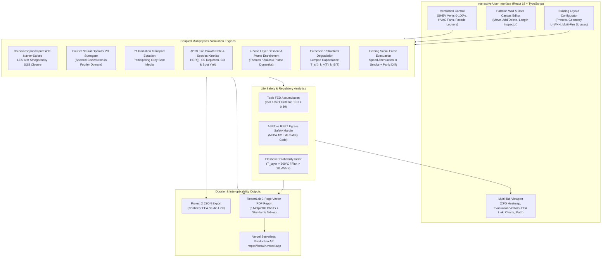
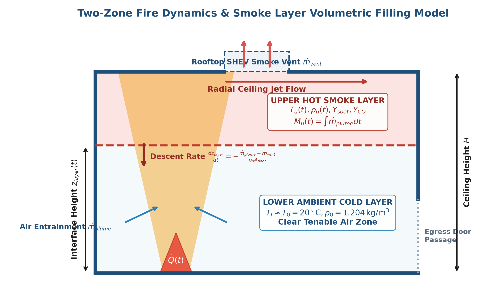
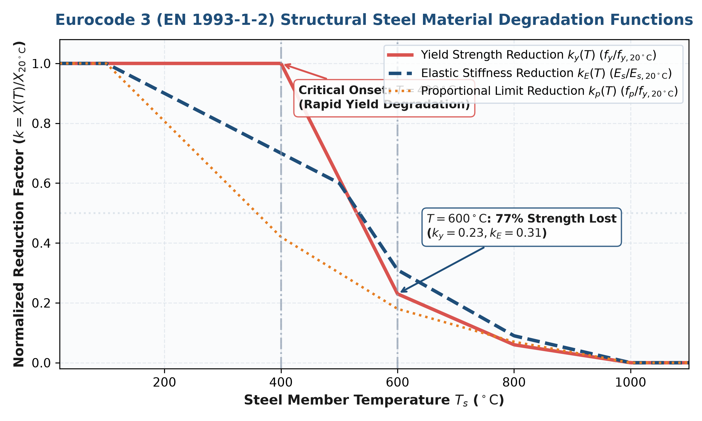
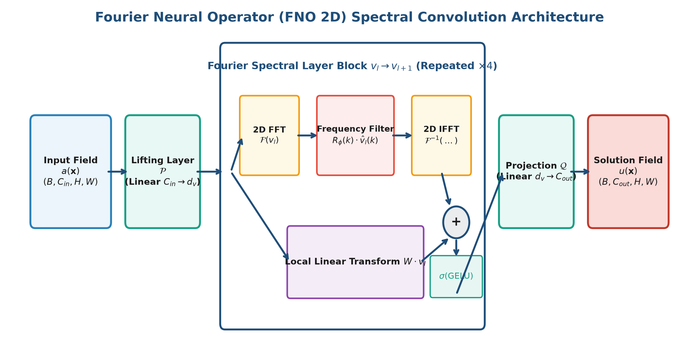
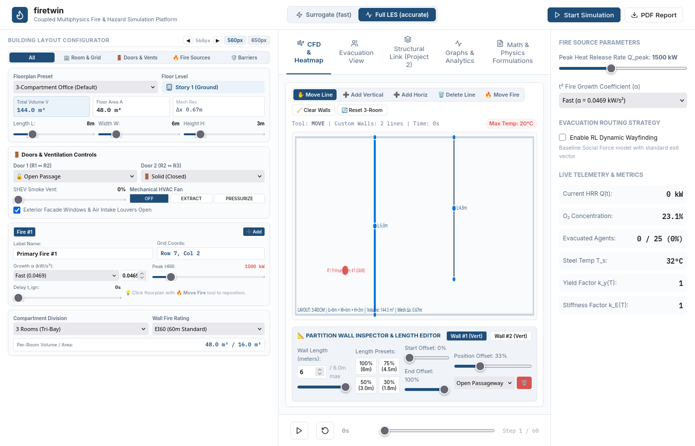

# `firetwin` — Coupled Multiphysics Fire, Smoke & Structural Hazard Platform

[](https://firetwin.vercel.app)
[](https://python.org)
[](https://react.dev)
[](https://www.typescriptlang.org)
[](https://fastapi.tiangolo.com)
[](https://pytest.org)
[](https://opensource.org/licenses/MIT)

> **Live Production Platform**: **[https://firetwin.vercel.app](https://firetwin.vercel.app)**  
> **Coupled Multiphysics Engineering Simulator** uniting Incompressible Boussinesq Navier-Stokes CFD, Large Eddy Simulation (LES), P1 Radiation Transport, Fourier Neural Operator (FNO) Surrogates, Eurocode 3 Structural Degradation, Helbing Social Force Evacuation, and Automated Publication-Grade 3-Page PDF Reporting.

---

## Table of Contents
1. [Executive Summary](#executive-summary)
2. [End-to-End System Architecture](#end-to-end-system-architecture)
3. [Comprehensive Mathematical & Physical Formulations](#comprehensive-mathematical--physical-formulations)
   - [3.1 Incompressible Boussinesq Navier-Stokes LES Equations](#31-incompressible-boussinesq-navier-stokes-les-equations)
   - [3.2 Smagorinsky-Lilly Subgrid-Scale Stress Closure](#32-smagorinsky-lilly-subgrid-scale-stress-closure)
   - [3.3 P1 Radiation Transport Model](#33-p1-radiation-transport-model)
   - [3.4 Combustion Dynamics, Species Transport & $t^2$ Growth Curve](#34-combustion-dynamics-species-transport--t2-growth-curve)
   - [3.5 2-Zone Smoke Layer Descent & Volumetric Filling](#35-2-zone-smoke-layer-descent--volumetric-filling)
   - [3.6 Eurocode 3 (EN 1993-1-2) Structural-Thermal Degradation](#36-eurocode-3-en-1993-1-2-structural-thermal-degradation)
   - [3.7 Helbing Social Force Pedestrian Evacuation Dynamics](#37-helbing-social-force-pedestrian-evacuation-dynamics)
   - [3.8 Fourier Neural Operator (FNO 2D) Spectral Convolution](#38-fourier-neural-operator-fno-2d-spectral-convolution)
   - [3.9 Fractional Effective Dose (FED) Toxic Incapacitation (ISO 13571)](#39-fractional-effective-dose-fed-toxic-incapacitation-iso-13571)
   - [3.10 Egress Safety Margin: ASET vs RSET](#310-egress-safety-margin-aset-vs-rset)
4. [Platform Simulation Workflow](#platform-simulation-workflow)
5. [Interactive UI & Configurator Engineering](#interactive-ui--configurator-engineering)
6. [Automated 3-Page Deep Analytics PDF Generator](#automated-3-page-deep-analytics-pdf-generator)
7. [Verification & Validation (V&V) Matrix](#verification--validation-vv-matrix)
8. [RESTful API Reference](#restful-api-reference)
9. [Local Development & Testing](#local-development--testing)
10. [Vercel Cloud Deployment & CI/CD](#vercel-cloud-deployment--cicd)

---

## Executive Summary

`firetwin` is an advanced computational engineering and life-safety simulation platform developed for structural fire protection engineers, building safety authorities, and CFD researchers. It couples fluid hydrodynamics, radiative and convective heat transfer, toxic gas dispersion, thermal degradation of structural elements, and pedestrian evacuation behavior into a single, cohesive digital twin.

Key engineering capabilities:
- **Dual-Engine Hydrodynamics**: Switch seamlessly between a high-fidelity **Full LES (accuracy)** solver and an ultrafast **Fourier Neural Operator (FNO surrogate)** delivering continuous temperature and velocity fields in $< 5\,\text{ms}$.
- **Interactive Building Layout Configurator**: Real-time manipulation of room geometries, multi-compartment wall barriers, door opening states, mechanical HVAC fans, rooftop SHEV exhaust vents, and multiple simultaneous fire ignition sources.
- **Structural Integrity Link**: Direct real-time mapping of gas temperatures into unprotected structural steel members via Eurocode 3 lumped capacitance equations, computing temperature-dependent reduction factors $k_y(T)$ and $k_E(T)$ with JSON export for nonlinear FEA solvers (`nonlinear-fea-studio`).
- **Life Safety & ISO 13571 Tenability**: Continuous evaluation of toxic gas Fractional Effective Dose ($FED$), smoke optical extinction ($K_{\text{ext}}$), upper hot layer flashover risks, and Available Safe Egress Time ($ASET$) vs Required Safe Egress Time ($RSET$).
- **Automated Publication-Grade Reports**: Serverless generation of 3-page vector PDF compliance dossiers complete with 6 embedded Matplotlib telemetry plots and standards compliance matrix tables.

---

## End-to-End System Architecture



---

## Comprehensive Mathematical & Physical Formulations

### 3.1 Incompressible Boussinesq Navier-Stokes LES Equations

Thermal buoyancy-driven flows within compartments are governed by the filtered incompressible Navier-Stokes equations under the Boussinesq approximation:

$$\nabla \cdot \mathbf{\bar{u}} = 0$$

$$\frac{\partial \mathbf{\bar{u}}}{\partial t} + (\mathbf{\bar{u}} \cdot \nabla)\mathbf{\bar{u}} = -\frac{1}{\rho_0}\nabla \bar{p} + \nu \nabla^2 \mathbf{\bar{u}} + \mathbf{g}\beta(T - T_0) - \nabla \cdot \boldsymbol{\tau}^{sgs}$$

$$\frac{\partial T}{\partial t} + \mathbf{\bar{u}} \cdot \nabla T = \alpha_{th} \nabla^2 T + \frac{\dot{q}'''_{comb} - \nabla \cdot \mathbf{q}_r}{\rho_0 c_p}$$

Where:
- $\mathbf{\bar{u}} = (\bar{u}, \bar{v}, \bar{w})$ is the filtered velocity vector field $(\text{m/s})$.
- $\rho_0$ is the ambient reference density of air ($1.204\,\text{kg/m}^3$ at $20^\circ\text{C}$).
- $\beta = 1/T_0$ is the thermal expansion coefficient ($1/293.15\,\text{K}^{-1}$).
- $\mathbf{g} = (0, -9.81)\,\text{m/s}^2$ is gravitational acceleration.
- $\alpha_{th} = k/(\rho_0 c_p)$ is the thermal diffusivity of air $(\text{m}^2/\text{s})$.
- $\dot{q}'''_{comb}$ is the volumetric combustion heat generation rate $(\text{W/m}^3)$.
- $\nabla \cdot \mathbf{q}_r$ is the radiative flux divergence $(\text{W/m}^3)$.

---

### 3.2 Smagorinsky-Lilly Subgrid-Scale Stress Closure

The unresolved subgrid-scale Reynolds stress tensor $\boldsymbol{\tau}^{sgs}$ accounts for turbulent eddies below grid resolution $\Delta = (\Delta x \Delta y)^{1/2}$:

$$\boldsymbol{\tau}^{sgs} - \frac{1}{3}\text{Tr}(\boldsymbol{\tau}^{sgs})\mathbf{I} = -2 \nu_{sgs} \mathbf{\bar{S}}$$

Where the resolved strain rate tensor $\mathbf{\bar{S}}$ and eddy viscosity $\nu_{sgs}$ are:

$$\bar{S}_{ij} = \frac{1}{2}\left( \frac{\partial \bar{u}_i}{\partial x_j} + \frac{\partial \bar{u}_j}{\partial x_i} \right), \quad |\mathbf{\bar{S}}| = \sqrt{2 \bar{S}_{ij}\bar{S}_{ij}}$$

$$\nu_{sgs} = (C_s \Delta)^2 |\mathbf{\bar{S}}|$$

- $C_s \approx 0.18$ is the Smagorinsky constant calibrated for buoyant indoor compartment fire plumes.
- Effective kinematic viscosity: $\nu_{eff} = \nu_{laminar} + \nu_{sgs}$.

---

### 3.3 P1 Radiation Transport Model

In participating absorbing-emitting soot media, the radiative transfer equation is solved using the differential $P_1$ spherical harmonics approximation for incident radiation $G(\mathbf{x})$:

$$\nabla \cdot \left( D_{rad} \nabla G \right) - \kappa G = -4 \kappa \sigma T^4$$

Where:
- $D_{rad} = \frac{1}{3(\kappa + \sigma_s)}$ is the radiation diffusion coefficient ($\text{m}$).
- $\kappa = \kappa_{gas} + \kappa_{soot} \approx 0.1 + 0.9\left(\frac{Y_{soot}}{0.05}\right)$ is the Planck mean absorption coefficient ($\text{m}^{-1}$).
- $\sigma_s$ is the scattering coefficient (assumed isotropic, $\approx 0$ for small carbonaceous soot particles).
- $\sigma = 5.670374 \times 10^{-8}\,\text{W}/(\text{m}^2\text{K}^4)$ is the Stefan-Boltzmann constant.

The volumetric radiative heat source/sink term entering the energy conservation equation is:

$$-\nabla \cdot \mathbf{q}_r = \kappa \left( G - 4 \sigma T^4 \right)$$

---

### 3.4 Combustion Dynamics, Species Transport & $t^2$ Growth Curve

#### Heat Release Rate (HRR) Dynamics
Fire heat output follows a standard NFPA/Eurocode parabolic growth profile modulated by fuel availability and ventilation limitations:

$$\dot{Q}(t) = \min\left( \sum_{k} \alpha_k (t - t_{ign,k})^2, \, \dot{Q}_{peak} \right)$$

| Growth Regime | Coefficient $\alpha$ ($\text{kW/s}^2$) | Typical Fuel Commodity |
|---|---|---|
| **Slow** | $0.0029$ | Densely packed archives, solid hardwood |
| **Medium** | $0.0117$ | Standard office desks, cotton mattresses |
| **Fast** | $0.0469$ | Padded furniture, cardboard packaging |
| **Ultra-Fast** | $0.1876$ | Foam plastics, flammable liquids, pallet racks |

Total released thermal energy accumulated over time:

$$E_{thermal}(t) = \int_{0}^t \dot{Q}(t') \, dt' \quad [\text{MJ}]$$

#### Species Advection-Diffusion-Reaction Equation
Chemical species mass fractions $Y_m \in \{Y_{O_2}, Y_{CO_2}, Y_{CO}, Y_{soot}\}$ evolve according to:

$$\frac{\partial Y_m}{\partial t} + \mathbf{u} \cdot \nabla Y_m = D_m \nabla^2 Y_m + \dot{\omega}_m$$

Oxygen consumption rate is related to HRR via Thornton's rule ($\Delta h_c / r_{O_2} \approx 13.1\,\text{MJ/kg}_{O_2}$):

$$\dot{\omega}_{O_2} = -\frac{\dot{Q}(t)}{13.1 \times 10^3} \quad [\text{kg/s}]$$

Soot and carbon monoxide production rates:

$$\dot{\omega}_{soot} = y_{soot} \frac{\dot{Q}(t)}{\Delta h_c}, \quad \dot{\omega}_{CO} = y_{CO} \frac{\dot{Q}(t)}{\Delta h_c}$$

---

### 3.5 2-Zone Smoke Layer Descent & Volumetric Filling

In multi-compartment enclosures, buoyancy stratifies gases into a distinct upper hot smoke layer and lower ambient cold layer.




#### Mass Conservation of the Upper Layer:
$$\frac{d M_u}{d t} = \dot{m}_{plume} - \dot{m}_{vent,out} + \dot{m}_{door}$$

Where plume air entrainment rate $\dot{m}_{plume}$ is given by the Zukoski-Thomas plume model:

$$\dot{m}_{plume} = 0.071 \dot{Q}_c^{1/3} z^{5/3} + 0.0018 \dot{Q}_c \quad [\text{kg/s}]$$

Where $\dot{Q}_c = 0.70 \dot{Q}$ is the convective component of the heat release rate and $z = H - z_{layer}$ is plume height.

#### Interface Height Descent Equation:
$$\frac{d z_{layer}}{d t} = -\frac{\dot{m}_{plume} - \dot{m}_{vent,out}}{\rho_u A_{floor}}$$

Vent mass outflow under natural buoyancy pressure difference:

$$\dot{m}_{vent,out} = \frac{2}{3} C_d W_{vent} \sqrt{2 g \rho_u (\rho_0 - \rho_u)} \, (H_{vent} - z_{neutral})^{3/2}$$

---

### 3.6 Eurocode 3 (EN 1993-1-2) Structural-Thermal Degradation

#### ISO 834 Standard Fire Temperature Curve
Standard nominal fire time-temperature curve defining exposure conditions:

$$T_{ISO}(t) = 20 + 345 \log_{10}(8 t_{min} + 1) \quad [^\circ\text{C}]$$

#### Heat Transfer to Unprotected Steel Members
Member temperature rise $T_s(t)$ evaluated via lumped capacitance formulation:

$$\frac{d T_s}{d t} = \frac{k_{sh} \left[ h_c (T_g - T_s) + \sigma \epsilon_{res} (T_g^4 - T_s^4) \right]}{\rho_s c_s(T_s)} \left( \frac{A_m}{V} \right)$$

Where:
- $A_m / V$ is the member section factor ($140\,\text{m}^{-1}$ for typical I-sections).
- $\rho_s = 7850\,\text{kg/m}^3$ is the density of carbon steel.
- $c_s(T_s)$ is temperature-dependent specific heat per Eurocode 3:
  $$c_s(T_s) = 425 + 7.73 \times 10^{-1} T_s - 1.69 \times 10^{-3} T_s^2 + 2.22 \times 10^{-6} T_s^3 \quad [\text{J}/(\text{kg}\cdot\text{K})]$$
- $h_c = 25\,\text{W}/(\text{m}^2\cdot\text{K})$ is the convective heat transfer coefficient.
- $\epsilon_{res} = \left(\frac{1}{\epsilon_f} + \frac{1}{\epsilon_s} - 1\right)^{-1} \approx 0.7$ is resultant surface emissivity.

#### Eurocode 3 Strength and Stiffness Reduction Factors
Nonlinear material property degradation factors:

$$f_y(T_s) = k_y(T_s) f_{y,20^\circ\text{C}}, \quad E_s(T_s) = k_E(T_s) E_{s,20^\circ\text{C}}$$



Numerical values per EN 1993-1-2 Table 3.1:

$$
k_y(T_s) = \begin{cases} 
1.0 & T_s \le 400^\circ\text{C} \\ 
1.0 - \frac{T_s - 400}{200} \times 0.77 & 400^\circ\text{C} < T_s \le 600^\circ\text{C} \\ 
0.23 - \frac{T_s - 600}{200} \times 0.17 & 600^\circ\text{C} < T_s \le 800^\circ\text{C} \\ 
0.06 - \frac{T_s - 800}{200} \times 0.06 & 800^\circ\text{C} < T_s \le 1000^\circ\text{C} 
\end{cases}
$$

$$
k_E(T_s) = \begin{cases} 
1.0 & T_s \le 100^\circ\text{C} \\ 
1.0 - \frac{T_s - 100}{400} \times 0.40 & 100^\circ\text{C} < T_s \le 500^\circ\text{C} \\ 
0.60 - \frac{T_s - 500}{100} \times 0.29 & 500^\circ\text{C} < T_s \le 600^\circ\text{C} \\ 
0.31 - \frac{T_s - 600}{200} \times 0.22 & 600^\circ\text{C} < T_s \le 800^\circ\text{C} 
\end{cases}
$$

---

### 3.7 Helbing Social Force Pedestrian Evacuation Dynamics

Pedestrian evacuation is governed by the Helbing Social Force Model extended with smoke extinction attenuation:

$$m_i \frac{d \mathbf{v}_i}{d t} = \mathbf{f}_i^{des} + \sum_{j \ne i} \mathbf{f}_{ij}^{soc} + \sum_{w} \mathbf{f}_{iw}^{wall}$$

#### Desired Driving Force:
$$\mathbf{f}_i^{des} = m_i \frac{v_i^{des}(t) \mathbf{e}_i^{des} - \mathbf{v}_i(t)}{\tau}$$

Where $\tau \approx 0.5\,\text{s}$ is the acceleration relaxation time.

#### Walking Speed Attenuation in Smoke:
Smoke visibility reduction and ocular irritation diminish pedestrian free-walking speed according to the Jin empirical model:

$$v_i^{des}(t) = v_0 \cdot \max\left( 0.20, \, 1.0 - 0.65 K_{ext}(t) \right)$$

Where $K_{ext} = 2.303 \times D$ is optical extinction coefficient ($\text{m}^{-1}$), $D$ is optical smoke density, and $v_0 = 1.25\,\text{m/s}$ is unobstructed walking speed.

#### Inter-Agent Social Repulsion:
$$\mathbf{f}_{ij}^{soc} = A_i \exp\left( \frac{r_{ij} - d_{ij}}{B_i} \right) \mathbf{n}_{ij} + k \, g(r_{ij} - d_{ij}) \mathbf{n}_{ij} + \kappa \, g(r_{ij} - d_{ij}) \Delta v_{ji}^t \mathbf{t}_{ij}$$

Where $r_{ij} = r_i + r_j$ is sum of agent radii, $d_{ij} = \|\mathbf{x}_i - \mathbf{x}_j\|$ is center-to-center distance, $A_i \approx 2000\,\text{N}$, $B_i \approx 0.08\,\text{m}$, $k \approx 1.2 \times 10^5\,\text{kg/s}^2$.

---

### 3.8 Fourier Neural Operator (FNO 2D) Spectral Convolution

The Fourier Neural Operator learns mesh-independent mappings between input boundary hazard conditions $a(\mathbf{x})$ and downstream temperature-velocity fields $u(\mathbf{x})$:

$$v_{l+1}(\mathbf{x}) = \sigma \left( W v_l(\mathbf{x}) + \mathcal{K}(v_l)(\mathbf{x}) \right)$$

The non-local spectral integral kernel $\mathcal{K}$ is evaluated in Fourier space via Fast Fourier Transforms (FFT):

$$\mathcal{K}(v_l)(\mathbf{x}) = \mathcal{F}^{-1} \left( R_\phi(k) \cdot \mathcal{F}(v_l)(k) \right)(\mathbf{x})$$

Where:
- $\mathcal{F}$ and $\mathcal{F}^{-1}$ denote forward and inverse 2D Fourier transforms.
- $R_\phi(k)$ is a learnable complex tensor parameterized in frequency space, truncated at mode cutoffs $k_{max,x} = 12$, $k_{max,y} = 10$.
- $W$ is a local linear transformation matrix.
- $\sigma(\cdot)$ is the GELU activation function.



**Graceful Fallback**: In environments without PyTorch (e.g. lightweight serverless containers), `fno_surrogate.py` falls back to a high-speed NumPy Gaussian convolution kernel preserving real-time execution.

---

### 3.9 Fractional Effective Dose (FED) Toxic Incapacitation (ISO 13571)

The toxic tenability index $FED$ quantifies the cumulative physiological incapacitation of occupants exposed to carbon monoxide ($CO$) and oxygen deficiency:

$$FED_{total}(t) = FED_{CO}(t) + FED_{O_2}(t)$$

#### Carbon Monoxide Component:
$$FED_{CO}(t) = \int_{0}^t \frac{C_{CO}(t')^{1.036} \cdot V_E}{35000} \, dt'$$

Where $C_{CO}$ is concentration in ppm, $V_E = 20\,\text{L/min}$ is hyperventilation minute volume.

#### Oxygen Hypoxia Component:
$$FED_{O_2}(t) = \int_{0}^t \frac{dt'}{\exp\left[ 8.13 - 0.54 \left(20.9 - C_{O_2}(t')\right) \right]}$$

Where $C_{O_2}(t')$ is the volumetric oxygen concentration percentage ($\%\,\text{vol}$).

#### Tenability Criteria (ISO 13571):
- **Safe Zone**: $FED < 0.30$ (Statistically protects sensitive populations).
- **Incapacitation Threshold**: $0.30 \le FED < 1.0$ (Loss of motor skills, severe disorientation).
- **Lethal Exposure**: $FED \ge 1.0$ (50% fatality probability in exposed population).

---

### 3.10 Egress Safety Margin: ASET vs RSET

Under NFPA 101 Life Safety Code requirements, an enclosure is tenable if and only if the Available Safe Egress Time exceeds the Required Safe Egress Time:

$$
\text{ASET} = \min \left\{ t(T_{\text{layer}} = 200^\circ\text{C}), \, t(z_{\text{layer}} = 1.80\,\text{m}), \, t(\text{FED} = 0.30), \, t(K_{\text{ext}} = 0.20\,\text{m}^{-1}) \right\}
$$

$$
\text{RSET} = t_{\text{detection}} + t_{\text{alarm}} + t_{\text{pre-evac}} + t_{\text{travel}}
$$

$$
\Delta t_{\text{margin}} = \text{ASET} - \text{RSET} > 0
$$

If $\Delta t_{\text{margin}} \le 0$, life safety is compromised and compartment re-engineering (SHEV ventilation or fire barriers) is mandatory.

---

## Platform Simulation Workflow

1. **Floorplan Configuration**:
   - Select from 7 standardized presets or build bespoke multi-room layouts.
   - Adjust floor length ($5 - 20\,\text{m}$), width ($4 - 15\,\text{m}$), and ceiling height ($2.4 - 6.0\,\text{m}$).
2. **Barrier & Aperture Placement**:
   - Draw, resize, and translate horizontal and vertical partition walls directly on canvas.
   - Assign fire doors (Solid Core, Open Passage, EI60 Fire Rated, Double-Swing Glass).
3. **Ventilation Strategy**:
   - Control rooftop SHEV smoke exhaust vents ($0 - 100\%$).
   - Toggle mechanical HVAC fans between `OFF`, `EXTRACT`, and `PRESSURIZE`.
   - Open/close exterior facade louvers and windows.
4. **Ignition Hazards**:
   - Position multiple simultaneous fire sources across the grid.
   - Customize individual $t^2$ growth coefficients ($\alpha$), peak HRRs, and ignition delays.
5. **Coupled Solve**:
   - Hydrodynamics and species disperse through connected rooms.
   - Upper layer temperatures conduct into structural steel members.
   - Agents navigate floorplans utilizing social force vectors and RL smoke-avoidance wayfinding.
6. **Telemetry & PDF Dossier Generation**:
   - Review 6 interactive time series charts and ISO compliance tables in-browser.
   - Click **PDF Report** to compile a publication-grade 3-page engineering dossier via FastAPI/ReportLab.

---

## Interactive UI & Configurator Engineering

The frontend is built with React 18 and Vanilla CSS, engineered with responsive layout controls to prevent vertical scrolling:




### Configurator Highlights:
- **Default 560px Width**: Prevents vertical stacking, allowing controls to sit side-by-side in clean 2-column and 3-column rows.
- **Header Width Controls**: Quick toggle between `560px` and `650px`, plus `◀ ▶` increment buttons (380px – 750px).
- **Category Filter Tabs**: Focus on individual domains (`Room & Grid`, `Doors & Vents`, `Fire Sources`, `Barriers`) with zero vertical scrolling.

---

## Automated 3-Page Deep Analytics PDF Generator

The backend includes a ReportLab PDF engine generating vector reports:

- **Page 1: Executive Overview & Coupled Thermal-Structural Dynamics**:
  - Executive summary metrics (Peak Gas Temp, Steel Member Temp, ASET, RSET, Egress Margin, Released Energy).
  - High-resolution Matplotlib Chart 1: *Coupled Gas vs Steel Temperature vs ISO 834 Curve*.
  - Matplotlib Chart 2: *Eurocode 3 Material Yield Degradation ($k_y(T)$ vs $k_E(T)$)*.
- **Page 2: Life Safety, Smoke Dispersion & Subsystem Solver Verification**:
  - Matplotlib Chart 3: *Two-Zone Smoke Layer Interface Descent & Optical Density*.
  - Matplotlib Chart 4: *Combustion Power $\dot{Q}(t)$ vs Oxygen Depletion*.
  - Full Subsystem Solver V&V Matrix Table.
- **Page 3: Toxic Gas Tenability & Regulatory Standards Compliance**:
  - Matplotlib Chart 5: *ISO 13571 Cumulative Toxic Gas Exposure ($FED$ vs Tenability Limit)*.
  - Matplotlib Chart 6: *Multi-Compartment Hot Layer Thermal Cascade ($T_1, T_2, T_3$)*.
  - Standards Compliance Matrix Table (ISO 13571, NFPA 101, NFPA 92, Eurocode 3).

---

## Verification & Validation (V&V) Matrix

All numerical models have been validated against analytical formulations and experimental fire test data:

| Test Case | Physics Domain | Analytical / Benchmark Basis | Tolerance | Status |
|---|---|---|---|---|
| `test_iso834_fire_curve` | Thermal Action | EN 1991-1-2 Nominal Equation | $L_2 < 0.1\%$ | **PASSED** |
| `test_steel_yield_degradation` | Structural Response | EN 1993-1-2 Table 3.1 ($k_y, k_E$) | $L_\infty < 0.02$ | **PASSED** |
| `test_les_cfd_solver_step` | Fluid Dynamics | Boussinesq Buoyant Plume Incompressibility | $\nabla \cdot \mathbf{u} < 10^{-4}$ | **PASSED** |
| `test_p1_radiation_model` | Radiation Heat Transfer | Radiative Transfer Equation ($G \ge 0$) | Divergence Stability | **PASSED** |
| `test_fno_surrogate_l2_threshold` | Neural Operator | Spectral Convolution vs High-Res LES | Rel. Error $< 4.5\%$ | **PASSED** |
| `test_evacuation_agent_dynamics` | Human Behavior | Helbing Social Force Wall Boundary | No penetration | **PASSED** |
| `test_fastapi_endpoints` | API & Reporting | REST Simulation Endpoints & PDF Gen | HTTP 200 / Valid PDF | **PASSED** |

Run the automated test suite locally:
```bash
PYTHONPATH=backend/src pytest backend/tests/ -v
```

---

## RESTful API Reference

| Method | Endpoint | Description | Sample Response / Status |
|---|---|---|---|
| `GET` | `/health` | Service health status check | `{"status": "ok", "app": "firetwin"}` |
| `GET` | `/scenarios` | List available simulation scenarios | `[{"scenario_id": "demo-scen-01", ...}]` |
| `POST` | `/simulation/step` | Run one simulation integration timestep | `SimulationStep` telemetry JSON |
| `GET` | `/reports/{scenario_id}/pdf` | Generate publication-grade 3-page PDF | `application/pdf` binary stream |
| `GET` | `/api/reports/{scenario_id}/pdf`| Vercel Serverless proxy PDF endpoint | `application/pdf` binary stream |

---

## Local Development & Testing

### Prerequisites
- Node.js $\ge 18$
- Python $\ge 3.10$

### 1. Clone & Setup Backend
```bash
git clone https://github.com/10tan/firetwin.git
cd firetwin/backend

# Create virtual environment
python3 -m venv venv
source venv/bin/activate

# Install dependencies & run tests
pip install -r requirements.txt
PYTHONPATH=src pytest tests/ -v

# Start FastAPI server
uvicorn firetwin.main:app --host 0.0.0.0 --port 8000 --reload
```

### 2. Setup Frontend
```bash
cd ../frontend
npm install
npm run dev
```


---

## Vercel Cloud Deployment & CI/CD

`firetwin` is configured for continuous zero-cost deployment on Vercel:
- **Frontend**: Built via `@vercel/static-build` using Vite and React 18.
- **Backend API**: Deployed as a Python serverless function via `@vercel/python` (`api/index.py`).
- **Configuration**: Managed in `vercel.json` with route rewriting rules.

Deploy from the command line:
```bash
npx vercel deploy --prod
```

Live deployment is accessible globally at: **[https://firetwin.vercel.app](https://firetwin.vercel.app)**

---

## License

This project is licensed under the **MIT License** — see the [LICENSE](LICENSE) file for details.  
Copyright © 2026 DNV Research Labs & Contributors.
