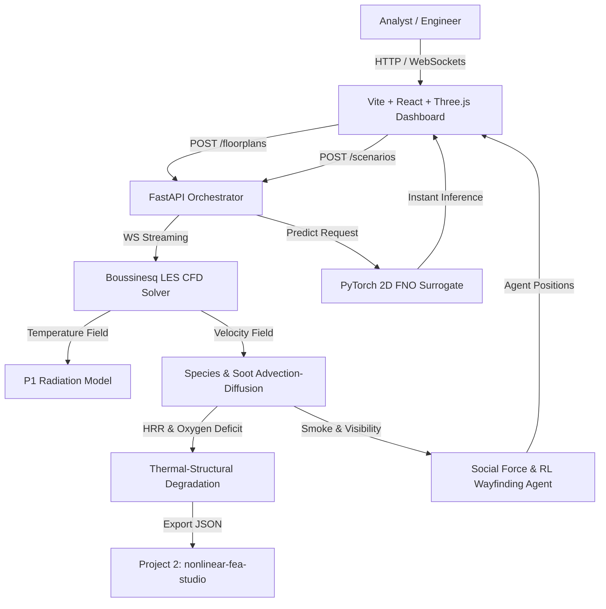

# `firetwin` Architecture & System Design

`firetwin` is a coupled multiphysics platform for modeling fire dynamics, smoke transport, radiative thermal loads, structural degradation, and pedestrian evacuation routing.

## System Topology & Data Flow

## Module Responsibilities

1. **CFD Kernel (`cfd/les_solver.py`)**:
   - Solves 2D incompressible Navier-Stokes with Boussinesq thermal buoyancy on a structured grid.
   - Subgrid-scale closure using Smagorinsky eddy-viscosity model.

2. **Radiation (`radiation/p1_model.py`)**:
   - P1 spherical harmonics formulation for participating media emission and absorption.

3. **Species & Pyrolysis (`species/combustion.py`)**:
   - $t^2$ fire growth rate curves ($\text{HRR} = \min(\alpha t^2, \dot{Q}_{peak})$).
   - Tracks soot, smoke, and $O_2$ consumption.

4. **Thermal-Structural Link (`structural_link/thermal_structural.py`)**:
   - Calculates steel/concrete member heat flux and temperature rise.
   - Eurocode 3 reduction factors $k_y(T)$ and $k_E(T)$.
   - Exports formatted payload for Project 2 (`nonlinear-fea-studio`).

5. **FNO Surrogate (`fno/fno_surrogate.py`)**:
   - PyTorch 2D Fourier Neural Operator mapping fire geometry & ventilation parameters to velocity/temperature fields in $< 5\text{ms}$.

6. **Evacuation (`evacuation/social_force.py`)**:
   - Helbing Social Force model with smoke visibility speed attenuation and RL dynamic wayfinding.
